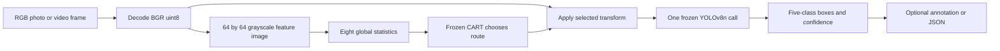

# SELight code map

Reviewed against the local source on 12 October 2026. The executable package is kept in place so existing imports, checkpoint signatures and commands continue to work. `research/` groups the new write-up and evidence; it does not replace the implementation.

## Project tree

```text
selight_project/
|-- selight/                       # Production package
|   |-- __init__.py                 # Package identity
|   |-- __main__.py                 # CLI dispatcher
|   |-- core.py                     # Image features, transforms, tree routing, hashes
|   |-- data.py                     # ExDark conversion, audit and GT preview
|   |-- detector.py                 # Frozen COCO YOLOv8n adapter
|   |-- experiment.py               # Development cache, CART training, evaluation, demo
|   |-- metrics.py                  # Class-aware F1 and pycocotools AP
|   `-- external.py                 # Official Zero-DCE++ checkpoint adapter
|-- configs/
|   |-- default.json                # Default detector/enhancer settings
|   |-- cpu.json                    # Explicit CPU execution
|   `-- gpu.json                    # RTX 4050 / CUDA execution
|-- models/
|   |-- yolov8n.pt                  # Frozen detector; never trained here
|   |-- policy.json                 # Exported selector, search results and provenance
|   `-- policy.rules.txt            # Human-readable tree; every leaf is original
|-- infer_photo.py                  # Single photo, annotated PNG and prediction JSON
|-- camera_benchmark.py             # Frozen-policy resolution/noise/JPEG stress
|-- video_benchmark.py              # File-video processing time, without rendering
|-- algorithm_reference.py          # Readable equivalent training/inference
|-- paired_comparison.py            # Paired mean-image-F1 bootstrap
|-- paired_ap_comparison.py          # Paired dataset-level COCO AP bootstrap
|-- scripts/
|   |-- import_external_datasets.py # Pinned HF LLVIP byte ranges; official Penn-Fudan masks
|   |-- external_audit.py           # Human person labels, dimensions, hashes and overlap
|   |-- evaluate_external.py        # Frozen person-only transfer; five methods, three repeats
|   |-- build_external_report.py    # External paired intervals, paper tables and gallery
|   |-- development_ablations.py    # Cache-derived validation ablations
|   |-- visual_audit.py             # Perceptual duplicate candidates and GT overlays
|   |-- external_pilot.py           # Original versus Zero-DCE++ validation pilot
|   |-- fetch_zero_dcepp.py          # Fetch official assets and record their hashes
|   |-- research_compare.py         # NEW: matched five-method validation benchmark
|   |-- build_research_pack.py      # NEW: metric checks, intervals, plots and gallery
|   |-- render_research_documents.py # NEW: evidence tables, standalone TeX and HTML
|   `-- export_research_pdf.py       # NEW: verified Markdown to shareable PDF
|-- tests/
|   |-- test_external.py            # VOC pixel edges and unannotated-class rejection
|   |-- test_core.py                # Features, transforms, matching, parsing, training
|   |-- test_pipeline.py            # Synthetic end-to-end pipeline with fake detector
|   |-- test_extensions.py          # Ablation semantics and explicit deduplication
|   |-- test_algorithm_reference.py # Reference equivalence and single detector call
|   |-- test_camera_benchmark.py    # Stress determinism and coordinate restoration
|   `-- test_ap_bootstrap.py        # Resampled AP versus explicit COCO recomputation
|-- third_party/zero_dcepp/          # Official architecture/checkpoint/reference script
|-- research/                       # New research package
|   |-- PAPER.md                    # Evidence-based manuscript
|   |-- paper.tex                   # Standalone LaTeX manuscript for native preview
|   |-- RESEARCH_CONTEXT.md          # Complete project/research handoff
|   |-- CODE_MAP.md                 # This file
|   |-- CODE_REVIEW.md              # Findings and unresolved limitations
|   |-- RUNBOOK.md                  # Exact run/reproduction commands
|   |-- showcase.html              # Local visual results gallery
|   |-- figures/                    # PNG and vector-PDF comparison figures
|   |-- experiments/validation_200/ # New raw predictions, timings, IDs and environment
|   |-- evidence.json               # Verified numbers, source hashes and audit checks
|   |-- comparison.csv              # Separate experiment scopes in machine-readable form
|   |-- code_inventory.json         # AST-derived definitions, imports, lines and hashes
|   |-- gallery.json                # Case IDs, selection rules and F1 values
|   |-- pdf_validation.json         # Shareable PDF source/hash and render checks
|   `-- artifact_hashes.json        # Research artifact integrity manifest
|-- data/raw/ExDark_extracted/ExDark # Existing junction to archived images
|-- data/external/                  # Imported LLVIP pilot, Penn-Fudan and provenance manifests
|-- outputs/                        # Existing local runs; not source code
|-- output/pdf/                     # Shareable research manuscript PDF
|-- .venv/                          # Existing working environment
|-- requirements*.txt               # Dependency declarations
|-- environment-lock.txt            # Previously verified exact package set
|-- setup_windows.ps1               # Fresh setup; preserves an existing .venv
|-- THIRD_PARTY_NOTICES.md           # External model attribution
`-- README.md                       # Starting point

../selight_project_backup_20261002/  # Preserved data, manifests, caches and legacy results
```

## What each module owns

| Module | Inputs | Main work | Outputs / contract |
|---|---|---|---|
| `core.py` | BGR uint8 image, config, optional policy | `features`, `Enhancer.apply`, `tree_route`, `select`; Unicode-safe decode; SHA256/JSON helpers | Eight finite features; one route; image geometry preserved |
| `data.py` | ExDark images, annotations, five-column metadata, explicit origin | `prepare`, `parse_boxes`, `audit`, `preview` | Manifest with IDs, split, GT boxes, content hashes; explicit duplicate omissions |
| `detector.py` | Config and local `.pt` checkpoint | `Detector.__init__`, `predict`, `sync`; validates COCO class order | `[class, score, x1, y1, x2, y2]`; classes remapped to 0..4 |
| `metrics.py` | Manifest rows and predictions keyed by image ID | `iou`, `counts`, `quality`, `summary` | COCO AP, AP50, AP-small, class AP, micro P/R/F1 and mean-image F1 |
| `experiment.py` | Matching manifest/config/checkpoint/cache/policy | `build_cache`, `route_label`, `train`, `evaluate`, `demo` | Cached route predictions; exported CART; raw predictions and stage timings; annotated video |
| `external.py` | RGB-convertible image and hash-verified official assets | `ZeroDCEPP.apply` with scale12, replicate padding and output crop | Native-size enhanced BGR uint8 image |
| `__main__.py` | CLI arguments | Dispatches prepare/audit/preview/cache/train/evaluate/demo/doctor | Entry point: `python -m selight` |

## Development flow

```mermaid
flowchart LR
  A[ExDark metadata and annotations] --> B[prepare and audit]
  B --> C[Train and validation manifest]
  C --> D[Three frozen-detector route predictions]
  D --> E[F1 quality and pooled timing cache]
  E --> F[Train-only route labels]
  F --> G[CART depth and lambda candidates]
  G --> H[Validation selects frozen policy]
  H --> I[Matching policy JSON and provenance]
```



The development cache contains train and validation records only. `train()` rejects test records and exact train/validation content overlap. Labels use GT during development. Inference has no GT access. All nine depth/lambda candidates use a fixed validation cost weight, so their objective values are comparable.

## Inference flow



Runtime uses exactly one detector call for each input frame. The current learned policy chooses original input at every leaf. It still extracts features and traverses the tree; it therefore adds computation while returning the same detector input.

## Important schemas

* Manifest record: `id`, relative `path`, `split`, `width`, `height`, `boxes`, `sha256`, `lighting`, `environment`. GT box format: `[class, x1, y1, x2, y2]`.
* Cache record: split/ID/content hash, eight features, per-route F1, median route time, three timing samples, raw predictions. Cache header binds checkpoint/config signature and manifest hash.
* Policy: exported tree arrays, class/feature order, threshold and fixed baselines, candidate selection, pooled relative cost, training/validation content hashes, checkpoint signature and source provenance.
* Prediction JSON: image ID to a list of `[class, score, x1, y1, x2, y2]`. Local classes are `person=0`, `bicycle=1`, `car=2`, `motorcycle=3`, `bus=4`; original COCO IDs are 0,1,2,3,5.
* Timing CSV: one row per image/method/repeat. New matched comparison separates selection-plus-enhancement and detector time. It excludes decode and rendering; legacy `evaluate()` timings include decode.

`signature()` binds the checkpoint's actual SHA256 and every config field except `device`, `threads`, and `weights` path. Relocating the same checkpoint or choosing CPU/GPU is permitted. Changing gamma, CLAHE, input size or thresholds requires a matching policy/cache. Historical policy metadata still records its original checkpoint path; the runtime verifies the relocated checkpoint content.

## How to read the source

Start with `core.py`, then `metrics.py`, `detector.py`, `data.py`, and `experiment.py`. Next read the CLI and the photo/video entry points. Read the reference implementation alongside `train()` to understand the label/candidate logic. Read the benchmark and bootstrap scripts last, checking their timing and resampling scopes.

`code_inventory.json` lists every owned Python module and test, its SHA256, line count, imports, and top-level definitions with exact line numbers. Third-party code and the environment are identified separately rather than counted as original project code.
