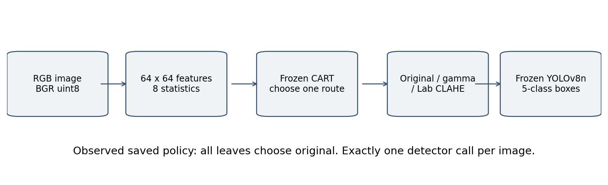
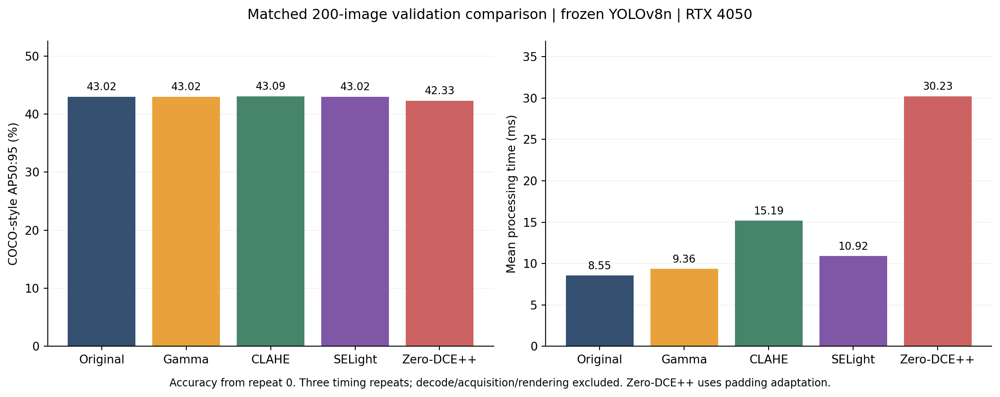
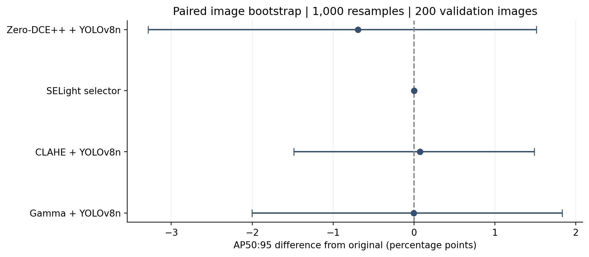
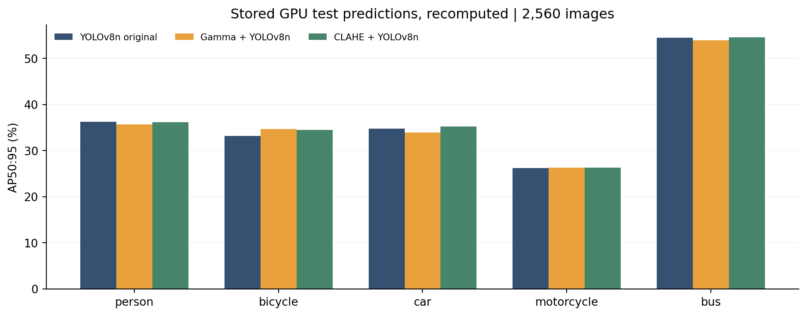
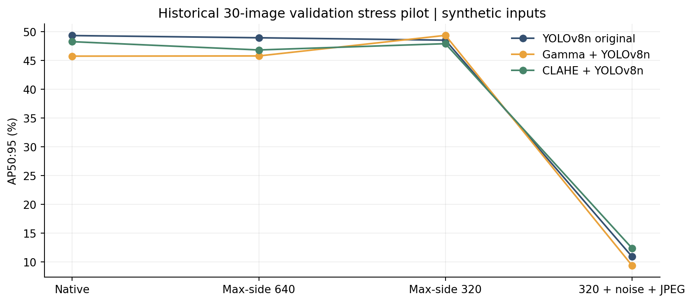
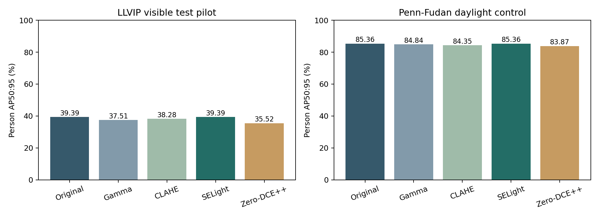

# SELight: An Audited Study of Enhancement Selection for Low-Light Object Detection with a Frozen Lightweight Detector

**Research prototype manuscript — 12 October 2026.** Author details and target-venue formatting remain to be supplied. Results describe the current implementation and its negative findings; they do not establish an adaptive detection improvement.

## Abstract

Low-light RGB images challenge lightweight object detectors through poor contrast, noise and loss of small-object information. We investigate whether a small detection-aware routing policy can improve a frozen COCO-pretrained YOLOv8n detector by selecting original input, gamma correction or luminance CLAHE. Eight image statistics feed a shallow decision tree trained from development-only route predictions using a per-image F1 proxy and pooled processing cost. We audit the five-class ExDark subset, reproduce stored experiment metrics, and perform a fresh matched comparison against fixed transforms and an official pretrained Zero-DCE++ adaptation on 200 validation images. The learned policy selects original input at every leaf. Its AP50:95 is 43.02%, identical to the original-input detector, while mean synchronized processing time increases from 8.55 to 10.92 ms on an RTX 4050 laptop GPU. Gamma, CLAHE and Zero-DCE++ obtain 43.02%, 43.09% and 42.33% AP respectively. Paired image-bootstrap intervals and diagnostic failures are reported instead of treating small point-estimate differences as improvement. Stored full-test results and development ablations corroborate the selector collapse. The study provides an auditable evaluation pipeline and documents the limitations of global-feature routing and F1-based route targets; it does not claim improved night vision or replacement of specialized cameras.

 Frozen external person-only evaluation on 200 LLVIP visible test images and all 170 Penn-Fudan images also produces exact selector/original equality; Penn-Fudan is a daylight control.

**Keywords:** low-light object detection; selective enhancement; frozen detector; ExDark; reproducibility; negative results.

## 1. Introduction

Ordinary RGB cameras are attractive for accessible perception demonstrations, but night images may contain insufficient signal, motion blur, compression artifacts and poorly resolved objects. Improving the appearance of an image does not automatically improve downstream detection. A fixed enhancer can help one object while damaging another or introducing false positives. Running every enhancer and detector at inference would add substantial computation and would require a deployable way to choose among their outputs.

This project studies a smaller alternative: predict one enhancement route from inexpensive global image features and then invoke a frozen detector once. The target application returns boxes, labels and confidence for person, bicycle, car, motorcycle and bus. It does not include character recognition, face identification, vehicle control or restoration of information absent from the input.

We ask whether development-trained enhancement selection improves detection while limiting measured processing overhead. Our contribution is an implemented and audited experimental pipeline, a controlled comparison with established input methods, and a documented failure of the current selector. We do not claim that CART, gamma correction, CLAHE, YOLOv8n or Zero-DCE++ are new methods, or that the current policy achieves a state-of-the-art result.

## 2. Related work and comparison scope

ExDark provides low-light RGB images with object annotations [1]. YOLOv8 supplies the frozen COCO-pretrained detector used here [2,3]. Gamma correction and OpenCV CLAHE provide inexpensive fixed controls [4]. Zero-DCE++ is an established learned curve-enhancement method [5]; we reuse its official architecture and checkpoint [6] with an explicit geometry-preserving adaptation. CART routing is implemented with scikit-learn [7]. COCO-style evaluation follows pycocotools [8].

SCI [9] and Retinexformer [10] are relevant enhancement approaches, but neither is reproduced in this study. Their published restoration scores or FPS cannot populate our detection comparison because the datasets, hardware, preprocessing and detector protocols differ. The measured baselines here share the same images and frozen detector. The Zero-DCE++ result is an adapted enhancer-plus-detector result, not its published enhancement benchmark.

## 3. Method

### 3.1 Detection and candidate transforms

The detector is a local COCO YOLOv8n checkpoint, kept frozen. Prediction uses batch 1, FP32, `imgsz=640`, confidence .001 for AP collection, NMS IoU .7 and maxDet 100. Classes are remapped from COCO IDs 0,1,2,3,5 to the five local target classes. F1 and displayed detections use confidence .25 and class-aware one-to-one matching at IoU >= .5.

Candidate routes preserve image size and box geometry. Original is the identity transform. Gamma uses a uint8 lookup table with exponent .65, under the convention `y=x**gamma`. CLAHE changes only Lab luminance, using clip limit 2 and an 8x8 tile grid. Runtime applies one selected route and performs exactly one detector call.

### 3.2 Features and route targets

Input is resized to 64x64 for feature extraction only and converted to normalized grayscale. Features are mean, standard deviation, the 10th/50th/90th percentiles, dark fraction below .2, bright fraction above .95 and average absolute finite-difference gradient. Detection receives the selected native-geometry image, not the 64x64 feature image.

For annotated development image i and route r, let q(i,r) be per-image F1 at the declared operating point. Empty GT and empty prediction sets receive utility 1. This convention makes target-negative strata important. For train-only median route times, relative extra cost is:

\[
c_r=\max\left(0,\frac{\operatorname{median}_{i\in T}t_{i,r}}{\operatorname{median}_{i\in T}t_{i,o}}-1\right),\qquad c_o=0.
\]

Eligible routes are original plus enhancements whose F1 gain is at least epsilon=.02. The training route maximizes:

\[
y_i=\underset{r\in E_i}{\arg\max}\,[q(i,r)-\lambda c_r],\qquad E_i=\{o\}\cup\{r:q(i,r)\ge q(i,o)+0.02\}.
\]

Ties prefer original, then gamma, then CLAHE. These targets use labels only during development; runtime has no GT access. The oracle obtained by selecting the highest-quality route with GT is a diagnostic upper bound for mean-image F1 only, not an achieved algorithm or AP bound.

### 3.3 CART selection and provenance

A DecisionTreeClassifier uses depth 2/3/4, training lambda 0/.01/.05, random_state=42 and minimum leaf size `max(2, floor(.02*N_train))`. Validation selects the candidate maximizing mean-image F1 minus a fixed .01 times pooled relative cost. The same fixed validation weight is used across the search. Ablations remove cost in both target/validation selection, remove the gain margin, use brightness alone, or remove CLAHE.

The selected tree has depth 2 and training lambda 0. Every exported leaf predicts original. The cost profile was measured on CPU and transferred to GPU deployment; this limitation is retained explicitly. Checkpoint/config and manifest hashes bind cache, policy and experiments. Device, threads and checkpoint path may change without changing its content signature; transform/detector settings may not.

*Figure 1. Implemented inference pipeline. The current policy returns original at every leaf; the tree does not achieve adaptive enhancement behavior.*

## 4. Experimental protocol

### 4.1 Data audit

The source ExDark metadata contains 7,363 images and 12 classes [1]. We evaluate only five COCO-overlap classes, retaining other images as target negatives. The legacy converter removed 18 exact duplicates and retained train 2,993 / validation 1,792 / test 2,560, totaling 7,345. These are modified published splits, not the unmodified official benchmark. Target-negative counts are 1,219 /785 /1,278. A prior visual review removed six cross-split near-duplicate records, producing a 7,339-image sensitivity manifest with train 2,993 / validation 1,790 / test 2,556. Perceptual candidate search is not an exhaustive proof of scene independence.

The annotation origin 0 convention was preserved. Visual overlays support gross box alignment but do not settle a possible one-pixel source convention. File hashes, GT coordinate bounds, image dimensions and class mapping are checked. The existing dataset junction resolves the archived images without copying or rewriting them.

### 4.2 Fresh matched validation experiment

We retain the production policy and configuration and sample 200 validation IDs using the existing stable SHA256 ordering. The validation set already participated in policy selection; this is an exploratory comparison, not a new untouched final test. The same 200 images, GT, YOLO checkpoint, target classes and thresholds are used for original, gamma, CLAHE, SELight and Zero-DCE++.

Zero-DCE++ uses the official `enhance_net_nopool(12)` architecture and Epoch99 checkpoint pinned to commit `09f202b690f82da939b8e6ec8535960ae97ad8bd`. Its adapter converts BGR to RGB float[0,1], replicate-pads to multiples of 12, crops only the enhanced output and rounds to uint8. The official test script crops input; our named `zero_dcepp_scale12_pad` adaptation preserves native geometry and GT objects.

Each complete method receives ten untimed warmups. Three timing repeats randomize method and image order with seed 42. CUDA is synchronized around processing. Timing includes route selection, enhancement, transfers, output quantization and detector processing. It excludes input decode, startup, acquisition, metric computation, drawing and writing. All raw timing rows and prediction repetitions are retained. Predictions are identical across repeats for each method; repeats measure timing, not independent accuracy.

The environment is Python 3.10.11, PyTorch 2.6.0+cu124, torchvision 0.21.0+cu124, Ultralytics 8.4.171, OpenCV 4.11.0.86, NumPy 2.2.6, scikit-learn 1.7.2 and pycocotools 2.0.11, on an RTX 4050 Laptop GPU. Earlier inspection recorded an i5-13450HX and 16 GB RAM. Software correctness is checked by 31 passing tests; these tests alone do not validate accuracy. Power/thermal histories are not controlled sufficiently to interpret timings as hardware specifications.

### 4.3 Metrics and uncertainty

The main quality outcome is five-class COCO-style AP50:95. We also report AP50, micro F1 and mean-image F1, distinguishing the latter training proxy from AP. Paired percentile 95% intervals use 1,000 matched image bootstrap resamples; dataset-level COCO AP is recomputed after resampling rather than averaging per-image AP. Images are assumed independent because session identifiers are unavailable. The identical selector has an analytically zero paired interval. Intervals are exploratory, with no correction for comparing several baselines.

Stored legacy GPU/CPU test predictions are re-evaluated using the original stable image order, including score-tie behavior. These are historical test results, not new test inference. Historical timing includes decode and is kept separate from the fresh processing-only timing. Full validation ablations are evaluated from cached route predictions and receive no inferred deployment timing.

## 5. Results

### 5.1 Fresh 200-image comparison

<!-- FRESH_TABLE:START -->
| Method | AP50:95 % | AP50 % | Micro F1 | Mean-image F1 | Mean ms | P95 ms |
| --- | --- | --- | --- | --- | --- | --- |
| Original | 43.019 | 71.987 | 0.6699 | 0.7493 | 8.55 | 10.98 |
| Gamma | 43.016 | 71.184 | 0.6691 | 0.7628 | 9.36 | 14.78 |
| CLAHE | 43.093 | 71.531 | 0.6854 | 0.7838 | 15.19 | 45.21 |
| SELight | 43.019 | 71.987 | 0.6699 | 0.7493 | 10.92 | 21.90 |
| Zero-DCE++ (adapt.) | 42.328 | 71.988 | 0.6608 | 0.7683 | 30.23 | 140.57 |
<!-- FRESH_TABLE:END -->

*Table 1. Fresh paired validation results. AP values are percentages. F1 values are 0..1. Mean and p95 describe 600 processing observations per method from 200 images and three repeats.*

SELight's prediction dictionary is exactly equal to original. It incurs approximately 27.8% more mean processing time while achieving no measured quality change. CLAHE's AP point estimate is 0.074 percentage points above original. Gamma is nearly unchanged in AP, while the adapted Zero-DCE++ score is 0.691 points lower. These are sample-conditional differences; uncertainty is reported below.

*Figure 2. Quality and processing cost on the same 200 validation images. This plot must not be ranked against the full-test table, which uses a different image set and timing scope.*

<!-- CI_TABLE:START -->
| Candidate | AP delta (pp) | AP 95% interval (pp) | F1 delta |
| --- | --- | --- | --- |
| Gamma | -0.003 | [-2.004, +1.830] | +0.0135 |
| CLAHE | +0.074 | [-1.483, +1.488] | +0.0345 |
| SELight | +0.000 | [+0.000, +0.000] | +0.0000 |
| Zero-DCE++ (adapt.) | -0.691 | [-3.288, +1.515] | +0.0190 |
<!-- CI_TABLE:END -->

*Table 2. Candidate-minus-original AP50:95 differences and paired image-bootstrap percentile 95% intervals, expressed in percentage points. Mean-image-F1 differences are separate from AP.*

*Figure 3. Sample uncertainty for AP differences. An interval crossing zero does not demonstrate superiority or establish equivalence.*

### 5.2 F1 proxy and target-negative strata

<!-- F1_STRATA_TABLE:START -->
| Method | Positive-image F1 | Negative-image F1 |
| --- | --- | --- |
| Original | 0.6987 | 0.8111 |
| Gamma | 0.6687 | 0.8778 |
| CLAHE | 0.7069 | 0.8778 |
| SELight | 0.6987 | 0.8111 |
| Zero-DCE++ (adapt.) | 0.6515 | 0.9111 |
<!-- F1_STRATA_TABLE:END -->

*Table 3. Fresh per-image F1 separated by presence of a target-class annotation. These utility averages are not COCO AP. For negatives, F1 is 1 only when no target predictions remain at the operating threshold.*

The ranking by mean-image F1 differs from the ranking by AP. This reinforces the need to distinguish the route-training proxy from the detector's main evaluation outcome. Target-negative images are retained to measure false positives, but their contribution can dominate utility averages and obscure object-bearing scenes.

### 5.3 Historical test and reviewed-split sensitivity

<!-- LEGACY_TABLE:START -->
| Device | Method | AP50:95 % | AP50 % | Micro F1 | Mean ms | P95 ms |
| --- | --- | --- | --- | --- | --- | --- |
| gpu | Original | 36.978 | 64.875 | 0.6568 | 23.68 | 38.76 |
| gpu | Gamma | 36.893 | 65.071 | 0.6576 | 24.37 | 39.66 |
| gpu | CLAHE | 37.354 | 65.060 | 0.6607 | 32.22 | 50.94 |
| gpu | threshold | 36.978 | 64.875 | 0.6568 | 26.44 | 42.57 |
| gpu | SELight | 36.978 | 64.875 | 0.6568 | 28.78 | 47.40 |
| cpu | Original | 36.978 | 64.887 | 0.6568 | 57.25 | 74.81 |
| cpu | Gamma | 36.886 | 65.073 | 0.6574 | 58.79 | 81.60 |
| cpu | CLAHE | 37.347 | 65.064 | 0.6606 | 63.81 | 83.29 |
| cpu | threshold | 36.978 | 64.887 | 0.6568 | 58.70 | 78.12 |
| cpu | SELight | 36.978 | 64.887 | 0.6568 | 603.57 | 78.93 |
<!-- LEGACY_TABLE:END -->

*Table 4. Stored full-test predictions on 2,560 images, metrics recomputed in this review. Timing is inherited and includes decode. AP is percent; mean and p95 are milliseconds. The anomalous CPU selector mean is preserved.*

Legacy GPU original and selector predictions also match exactly. Fixed CLAHE has a small AP point-estimate gain on this test. It was not substituted for the policy after observing the test. The reviewed 2,556-image sensitivity subset preserves this pattern: GPU original/selector approximately 36.980% AP and CLAHE37.356%. That subset is not a fresh independent test.

One historical CPU decode event lasts approximately 69.6 minutes, producing a very large selector mean despite an ordinary p95. The logs do not establish the cause. Its raw contribution is retained and cannot be interpreted as selector compute cost. Fresh processing-only measurements provide a separate protocol instead of silently editing legacy timings.

*Figure 4. Class-wise AP from stored GPU test predictions. Gains and losses vary by class; the unchanged selector matches original.*

### 5.4 Ablations and stress

<!-- ABLATION_TABLE:START -->
| Variant | AP50:95 % | Mean-image F1 | Route counts |
| --- | --- | --- | --- |
| full | 38.714 | 0.7653 | {'original': 1792} |
| no_cost | 38.714 | 0.7653 | {'original': 1792} |
| no_margin | 38.714 | 0.7653 | {'original': 1792} |
| brightness_only | 38.714 | 0.7653 | {'original': 1792} |
| no_clahe | 38.714 | 0.7653 | {'original': 1792} |
| original | 38.714 | 0.7653 | {'original': 1792} |
| gamma | 38.290 | 0.7585 | {'gamma': 1792} |
| clahe | 38.538 | 0.7607 | {'clahe': 1792} |
| threshold | 38.714 | 0.7653 | {'original': 1792} |
| brightness_tree | 38.714 | 0.7653 | {'original': 1792} |
| best_fixed | 38.714 | 0.7653 | {'original': 1792} |
<!-- ABLATION_TABLE:END -->

*Table 5. Full 1,792-image validation results from cached predictions. The five ablation policies collapse to original. No fresh timing is inferred from this cache-derived table.*

The current tree's collapse cannot be attributed solely to its declared cost penalty or .02 margin: removing either did not change the chosen validation behavior. Global statistics, shallow classification and route imbalance remain hypotheses for future development. Annotation-aware oracle F1 headroom does not establish that these features can recover it.

The historical 30-image stress pilot applies max-side downsampling, additive RGB Gaussian noise with sigma 5 on the uint8 scale, and JPEG quality 50. Original AP drops from 49.33% on native inputs to 10.95% under the combined severe condition. This measures synthetic input degradation, not sensor calibration, calibrated lux or the performance of inexpensive cameras. The four variants are correlated transformations of 30 images, not 120 independent captures.

*Figure 5. Historical synthetic-stress validation pilot. Reduction in source detail can sharply affect detection even when detector size remains 640.*

### 5.5 Qualitative output showcase

`showcase.html` and `gallery.json` provide matched ground-truth and five-method detection strips. Cases include the largest Zero-DCE++ F1 gain, largest decline, hardest target-positive original example and first stable-sampled examples for each target class. Each case's selection rule is disclosed. Yellow dashed boxes denote GT and cyan solid boxes denote predictions at confidence >= .25.

The gallery intentionally includes failures; it is diagnostic and not a representative success-rate estimate. The supplied video is an ExDark slideshow, and frame-by-frame demo output does not establish live-camera latency, temporal restoration or accuracy on phone recordings.

### 5.6 Frozen external dataset transfer

We import 200 of the 3,463 visible test images from the LLVIP archive mirrored on Hugging Face [11], pinned at revision e50976add2fcca00b0db0f3bba59ed486d8c1f6d. The cohort consists of the first 200 visible/test archive paths sorted by SHA256(path), declared before inference; it is a sampled pilot, not the full official benchmark. Original-resolution visible images are used; infrared and training images are not imported. LLVIP is predominantly low-light, but contains some daytime scenes, so we do not assert that every sampled frame is night. The mirror's equivalence to the official 2023 corrected annotation release is unverified. We interpret its XML as PASCAL VOC 1-based inclusive endpoints and convert to 0-based half-open edges; the mirror does not explicitly resolve the original coordinate convention.

We also import all 170 official Penn-Fudan images and their human instance masks from the University of Pennsylvania website [12]. Tight person boxes use minimum foreground coordinates and maximum coordinates plus one. The released archive contains 423 person instances: 345 described on the homepage plus 78 small/occluded additions documented in its readme.txt and added-object-list.txt. Both mask IDs and supplied text-annotation counts verify 423. This is a daylight domain control, not evidence of low-light performance, and no official held-out split is claimed.

The ExDark-trained policy, YOLOv8n checkpoint, enhancer settings and thresholds are frozen. No fitting or parameter selection uses either external cohort. Only person detections are scored because other detector classes are unannotated; person AP is not comparable to five-class ExDark AP. Exact file hashes find no within-cohort duplicate or overlap with the reference ExDark manifest. Unknown overlap with detector pretraining, near duplicates and scene/session dependence remain limitations. The two datasets run sequentially on the same GPU, each with ten warmups per method, three repetitions and randomized method/image order. Timing excludes image decode, metrics and rendering. Earlier overlapping runs are excluded from timing and final results.

| Dataset | Images | Method | Person AP50:95 % | Person AP50 % | Micro F1 | Mean ms | P95 ms |
| --- | --- | --- | --- | --- | --- | --- | --- |
| LLVIP visible test pilot | 200 | Original | 39.395 | 74.638 | 0.7537 | 8.50 | 10.52 |
| LLVIP visible test pilot | 200 | Gamma | 37.512 | 70.346 | 0.7384 | 10.23 | 15.45 |
| LLVIP visible test pilot | 200 | CLAHE | 38.276 | 72.408 | 0.7375 | 17.21 | 22.25 |
| LLVIP visible test pilot | 200 | SELight | 39.395 | 74.638 | 0.7537 | 9.70 | 11.50 |
| LLVIP visible test pilot | 200 | Zero-DCE++ (adapt.) | 35.524 | 65.122 | 0.6907 | 30.19 | 35.86 |
| Penn-Fudan daylight control | 170 | Original | 85.362 | 96.844 | 0.7554 | 8.84 | 10.82 |
| Penn-Fudan daylight control | 170 | Gamma | 84.840 | 96.848 | 0.7698 | 9.14 | 11.31 |
| Penn-Fudan daylight control | 170 | CLAHE | 84.355 | 96.825 | 0.7663 | 9.95 | 14.92 |
| Penn-Fudan daylight control | 170 | SELight | 85.362 | 96.844 | 0.7554 | 9.62 | 11.84 |
| Penn-Fudan daylight control | 170 | Zero-DCE++ (adapt.) | 83.868 | 96.736 | 0.7782 | 14.66 | 20.75 |

*Table 6. Fresh external person-only detection results; accuracy uses repetition zero and timing pools three repetitions. These are local measurements, not published benchmark scores.*

| Dataset | Candidate | AP delta (pp) | Conditional 95% interval (pp) |
| --- | --- | --- | --- |
| LLVIP visible test pilot | Gamma | -1.882 | [-2.873, -1.017] |
| LLVIP visible test pilot | CLAHE | -1.119 | [-2.096, -0.099] |
| LLVIP visible test pilot | SELight | +0.000 | [+0.000, +0.000] |
| LLVIP visible test pilot | Zero-DCE++ (adapt.) | -3.871 | [-5.362, -2.350] |
| Penn-Fudan daylight control | Gamma | -0.522 | [-1.112, -0.067] |
| Penn-Fudan daylight control | CLAHE | -1.007 | [-1.775, -0.365] |
| Penn-Fudan daylight control | SELight | +0.000 | [+0.000, +0.000] |
| Penn-Fudan daylight control | Zero-DCE++ (adapt.) | -1.493 | [-2.198, -0.827] |

*Table 7. Paired person AP differences relative to original input with 500 image resamples (seed 42). Intervals are conditional on images; LLVIP frames from common scenes may be correlated, and intervals do not establish population-level significance. Identical selector predictions have an exact zero difference.*

Both external cohorts retain exact SELight/original prediction equality. Enhancement point estimates are lower than original person AP on these cohorts. The results extend the negative selector finding across two external image collections without establishing five-class or session-independent generalization. `external_results.json`, `external_comparison.csv` and the local showcase retain provenance, raw predictions, route counts, timings and diagnostic examples.

*Figure 6. Person AP50:95 for the two separately evaluated external cohorts. LLVIP is a visible test pilot; Penn-Fudan is a daylight control. The collections are not pooled into one accuracy value.*

## 6. Discussion and limitations

The investigated selector implements the intended single-route architecture but fails to exploit enhancement opportunities in its current learned policy. Unweighted route classification on a dominant original class may collapse even when some images benefit from enhancement. Eight global luminance/gradient statistics may miss local object information. These are plausible mechanisms, not experimentally isolated causes. A utility-prediction objective or local features could be studied only under a new declared development protocol.

The route cost model was profiled on CPU and transferred to GPU. Mean-image F1 is not AP, target-negative utility can change method rankings, and device-specific profiles would be required for a deployment cost claim. ExDark scene independence is not fully verified, annotation origin remains uncertain by one pixel, and the 200-image experiment is validation-only with multiple exploratory comparisons. The original test has already been examined.

SCI/Retinexformer, alternative detectors, genuine labelled phone sessions, calibrated illuminance, energy use and Android inference are not measured. Images transformed by resizing/noise/JPEG do not simulate a complete camera. No method is shown to recover clipped or absent signal or to replace infrared/thermal hardware. A stronger final study needs an untouched session-grouped capture test and a justified algorithmic advance.

## 7. Reproducibility and conclusion

The repository preserves source, trained policy, detector checkpoint, optional enhancer assets, raw predictions, stage timings, selected IDs, hashes, metric checks, paired intervals and figure-generation scripts. `CODE_MAP.md` explains the complete implementation tree; `RUNBOOK.md` supplies exact commands. `evidence.json` separates fresh validation, historical test, ablations and reviewed-split sensitivity. Plot PDFs are provided for later manuscript export. Primary data/model attribution is retained; underlying ExDark photographs may have separate rights.

The current evidence supports a reproducible low-light detection prototype and a negative selector result. The saved policy produces the same detections as the original-input detector at additional measured cost. Small fixed-transform differences require cautious interpretation, and a learned enhancement network does not guarantee downstream AP improvement. The contribution is the audited pipeline and transparent empirical finding, not demonstrated adaptive superiority.

## References

1. Yuen Peng Loh and Chee Seng Chan. *Getting to Know Low-light Images with The Exclusively Dark Dataset.* Computer Vision and Image Understanding 178,30–42,2019. [Paper](https://arxiv.org/abs/1805.11227), [official dataset](https://github.com/cs-chan/Exclusively-Dark-Image-Dataset).
2. Ultralytics. *YOLOv8 model documentation.* [Official documentation](https://docs.ultralytics.com/models/yolov8/). The local checkpoint/package hash and version define this experiment.
3. Tsung-Yi Lin et al. *Microsoft COCO: Common Objects in Context.* ECCV 2014. [Paper](https://arxiv.org/abs/1405.0312).
4. OpenCV. *Histogram equalization and CLAHE.* [Official documentation](https://docs.opencv.org/4.x/d5/daf/tutorial_py_histogram_equalization.html). The implemented variant modifies Lab luminance.
5. Chongyi Li, Chunle Guo and Chen Change Loy. *Learning to Enhance Low-Light Image via Zero-Reference Deep Curve Estimation.* IEEE TPAMI,2021. [Paper](https://arxiv.org/abs/2103.00860).
6. Li-Chongyi. *Official Zero-DCE++ implementation.* [Repository](https://github.com/Li-Chongyi/Zero-DCE_extension), fixed commit 09f202b690f82da939b8e6ec8535960ae97ad8bd. Local asset hashes are recorded in `third_party/zero_dcepp/provenance.json`.
7. Scikit-learn. *DecisionTreeClassifier API.* [Official documentation](https://scikit-learn.org/stable/modules/generated/sklearn.tree.DecisionTreeClassifier.html). Local version 1.7.2 is recorded.
8. COCO authors. *pycocotools COCOeval implementation.* [Official code](https://github.com/cocodataset/cocoapi/blob/master/PythonAPI/pycocotools/cocoeval.py). Local package version 2.0.11 is recorded.
9. Long Ma et al. *Toward Fast, Flexible, and Robust Low-Light Image Enhancement.* CVPR 2022. [Paper](https://arxiv.org/abs/2204.10137). Related work only; not locally benchmarked.
10. Yuanhao Cai et al. *Retinexformer: One-stage Retinex-based Transformer for Low-light Image Enhancement.* ICCV 2023. [Paper](https://arxiv.org/abs/2303.06705). Related work only; not locally benchmarked.

11. Xinyu Jia et al. *LLVIP: A Visible-infrared Paired Dataset for Low-light Vision.* ICCV Workshops 2021. [Paper](https://arxiv.org/abs/2108.10831), [official dataset and terms](https://github.com/bupt-ai-cz/LLVIP), [pinned Hugging Face mirror](https://huggingface.co/datasets/McCheng/LLVIP/tree/e50976add2fcca00b0db0f3bba59ed486d8c1f6d).
12. Liming Wang, Jianbo Shi, Gang Song and I-fan Shen. *Object Detection Combining Recognition and Segmentation.* ACCV 2007. [Official Penn-Fudan dataset](https://www.cis.upenn.edu/~jshi/ped_html/).
